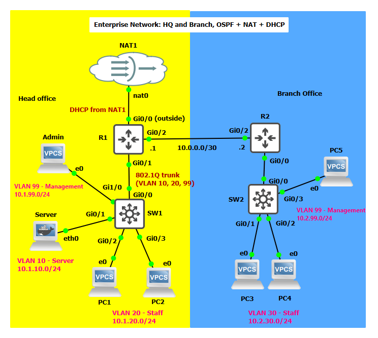
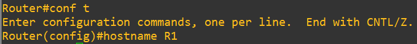
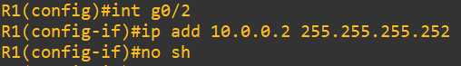
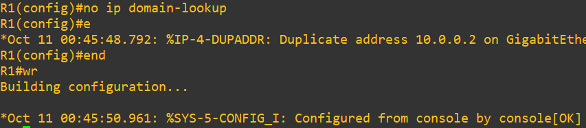
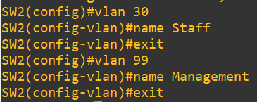
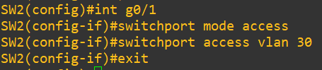
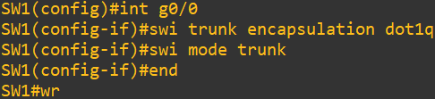

Diagnosing a disabled router interface configuration issue.
Diagnosing a disabled router interface configuration issue.

No, don’t put an IP on Gi0/1 itself. That port is the trunk to SW1, so the gateway addresses go on sub-interfaces, one per VLAN. Your output shows two problems:

    Gi0/1 is administratively down. It needs no shutdown.
    There are no sub-interfaces yet. The Server’s gateway, 10.1.10.1, doesn’t exist on R1 until you create the VLAN 10 sub-interface.

Fix on R1

    Bring up the physical port. Enter interface gigabitethernet 0/1 and run no shutdown. Leave it without an IP.
    Create the VLAN 10 sub-interface. Enter interface gigabitethernet 0/1.10, set encapsulation dot1Q 10, then add the address 10.1.10.1 with mask 255.255.255.0.
    Repeat for the other VLANs. Use .20 (VLAN 20, 10.1.20.1) and .99 (VLAN 99, 10.1.99.1). The number after the dot is just a label, so matching it to the VLAN ID keeps things readable. The number after dot1Q must match the VLAN exactly.
    Check with show ip interface brief. Gi0/1 and the three sub-interfaces should show up/up.

You can leave Gi0/0 (to NAT1) down for now, since you’ll deal with it in the NAT phase.
If the sub-interfaces stay down or the ping still fails

Check these in order:

    SW1 Gi0/0: it must be no shutdown, and a trunk with dot1q encapsulation. If the switch side is down, R1’s Gi0/1 stays up/down.
    VLANs exist on SW1: show vlan brief should list 10, 20 and 99.
    SW1 trunk allows VLAN 10: show interfaces trunk.
    SW1 Gi0/1 (Server port): access mode, VLAN 10, and not shut down.
    Server: ip a should show 10.1.10.10/24, with the default gateway 10.1.10.1.

Then ping 10.1.10.1 from the Server again. Tell me the output of show ip interface brief and show interfaces trunk if it still fails, and I’ll help you find it.

# Secure-Enterprise-Network Two-site enterprise network (Head Office and Branch Office) built in GNS3 with Cisco IOSv and IOSvL2. ## Objective Design and build a small enterprise network that connects a Head Office to a Branch Office, with segmented VLANs, centralized DHCP and DNS, internet access

pasted

here the readme that i change
Ran a command, created a file, shared files

I cleaned up your changes in README.md. Please check two things I changed on my own.

Fixes

    Server IP: your line still had the 10.1.10.10 /24 space that caused the error earlier. It’s now 10.1.10.10/24 dev eth0, in a code block, placed after the router IP section.
    Sub-interfaces: this is now a proper part of section 3 with full commands. I added no shutdown on the physical Gi0/1, because that was the reason your ping failed.
    Troubleshooting: I added two rows for problems you actually hit, the ip addr add errors and the Gi0/1 administratively down issue. Keep them if the fixes work for you.

Two things to check

    Project status: I changed “Trunk and inter-VLAN routing” to unchecked and moved it to “In progress”, since you can’t ping R1 yet. Tick it again once the ping from the Server works. A README that claims more than it proves hurts you in interviews.
    New screenshot names: 02b-server-ip.png and 07-subinterfaces.png. Save your images under those names so the links work.

Readme
Document·MD 

can u change the style to make the reader comfy to read
Ran a command, created a file, shared files

I restyled README.md so it’s easier to skim. The content and facts are the same as before.

    Overview and jump links: a short at-a-glance table and a navigation line at the top, so readers see the project in a few seconds.
    Project status table: ✅ Done, 🔄 In progress and ⬜ Planned, instead of checkboxes.
    Collapsible command blocks: each step shows a one-line goal, and the commands and screenshots sit inside click-to-expand sections. If you’d rather keep everything visible, delete the <details> and <summary> lines and their closing tags.
    Callouts: the Server restart note and the IOSvL2 trunk note stand out in highlighted boxes.
    Troubleshooting: each problem is now a small Symptom, Cause and Fix list, which reads better than a wide table full of code.
    Folder tree: the repository structure is drawn as a tree.

The collapsible sections and the highlighted boxes render on GitHub, but some other previews, like the VS Code one, may show them plainly.
Readme
Document·MD 


Claude is AI and can make mistakes.
Readme · MD
# Secure-Enterprise-Network
 
Two-site enterprise network (Head Office and Branch Office) built in GNS3 with Cisco IOSv and IOSvL2.
 
**Jump to:** [Overview](#overview) · [Topology](#topology) · [Project status](#project-status) · [Network design](#network-design) · [How I built it](#how-i-built-it) · [Verification](#verification) · [Troubleshooting](#troubleshooting) · [What I learned](#what-i-learned) · [Repository structure](#repository-structure)
 
---
 
## Overview
 
Design and build a small enterprise network that connects a Head Office to a Branch Office, with segmented VLANs, centralized DHCP and DNS, internet access through NAT, and basic security.
 
| | |
|---|---|
| **Sites** | Head Office (HQ) and Branch Office |
| **VLANs** | 10 Server, 20 Staff, 30 Staff (Branch), 99 Management |
| **Devices** | 2 routers (IOSv), 2 switches (IOSvL2), 1 Docker server, 1 admin PC, 4 PCs (VPCS) |
| **Tools** | GNS3, Cisco IOSv 15.9(3)M6, Cisco IOSvL2 [version], VPCS, Docker |
 
**Technologies**
 
- **Done:** `VLANs` `802.1Q trunking`
- **In progress:** [`inter-VLAN routing`] [`DHCP relay`] [`NAT/PAT`] [`OSPF`] [`ACLs`] [`SSH`] [`port security`]
---
 
## Topology
 

 
---
 
## Project status
 
| Step | Task | Status |
|:---:|---|:---:|
| 1 | Hostnames, IP addresses, DNS lookup disabled | ✅ Done |
| 2 | VLANs and access ports | ✅ Done |
| 3 | Trunk and inter-VLAN routing | 🔄 In progress |
| 4 | NAT/PAT on R1 | ⬜ Planned |
| 5 | DHCP and DNS with relay | ⬜ Planned |
| 6 | OSPF | ⬜ Planned |
| 7 | ACLs and hardening | ⬜ Planned |
 
---
 
## Network design
 
### VLAN plan
 
| VLAN | Name | Subnet | Site |
|:---:|---|---|---|
| 10 | Server | 10.1.10.0/24 | HQ |
| 20 | Staff | 10.1.20.0/24 | HQ |
| 99 | Management | 10.1.99.0/24 | HQ |
| 30 | Staff | 10.2.30.0/24 | Branch |
| 99 | Management | 10.2.99.0/24 | Branch |
 
### IP address table
 
| Device | Interface | IP address | Prefix | Default gateway | Notes |
|---|---|---|:---:|---|---|
| R1 | Gi0/0 | DHCP | - | - | Outside (NAT1) |
| R1 | Gi0/1 | no IP | - | - | 802.1Q trunk to SW1 (VLAN 10, 20, 99) |
| R1 | Gi0/1.10 | 10.1.10.1 | /24 | - | VLAN 10 gateway |
| R1 | Gi0/1.20 | 10.1.20.1 | /24 | - | VLAN 20 gateway |
| R1 | Gi0/1.99 | 10.1.99.1 | /24 | - | VLAN 99 gateway |
| R1 | Gi0/2 | 10.0.0.1 | /30 | - | WAN to R2 |
| R2 | Gi0/2 | 10.0.0.2 | /30 | - | WAN to R1 |
| R2 | Gi0/0 | no IP | - | - | 802.1Q trunk to SW2 (VLAN 30, 99) |
| R2 | Gi0/0.30 | 10.2.30.1 | /24 | - | VLAN 30 gateway |
| R2 | Gi0/0.99 | 10.2.99.1 | /24 | - | VLAN 99 gateway |
| SW1 | Vlan99 | 10.1.99.2 | /24 | 10.1.99.1 | Management |
| SW2 | Vlan99 | 10.2.99.2 | /24 | 10.2.99.1 | Management |
| Server | eth0 | 10.1.10.10 | /24 | 10.1.10.1 | DHCP and DNS |
| Admin | e0 | 10.1.99.10 | /24 | 10.1.99.1 | Management PC |
| PC1-PC4 | e0 | DHCP | - | From DHCP | Addresses from the Server |
 
---
 
## How I built it
 
Each step has a goal, then the commands and screenshots. Click a heading to expand it.
 
### Step 1: Hostnames, IP addresses and DNS lookup
 
> **Goal:** give every device a name and an address, and stop the CLI from hanging on typos.
 
<details>
<summary><b>Hostname</b> (repeat on every router and switch with its own name)</summary>
```
enable
configure terminal
hostname R1
end
```
 
- `enable` enters privileged EXEC mode (the prompt ends with `#`).
- `configure terminal` enters global configuration mode.
- `hostname R1` sets the device name.
- `end` returns to privileged EXEC mode.

 
</details>
<details>
<summary><b>IP address</b> (example: the R1 WAN link; repeat for every routed interface in the table)</summary>
```
enable
configure terminal
interface gigabitethernet 0/2
ip address 10.0.0.1 255.255.255.252
no shutdown
exit
```
 
- `interface gigabitethernet 0/2` selects the interface to configure.
- `ip address` sets the IP address and subnet mask.
- `no shutdown` brings the interface up.
- `exit` returns to global configuration mode.

 
</details>
<details>
<summary><b>Static IP for the Server</b> (Docker/Ubuntu node, so it uses Linux commands, not IOS)</summary>
```
ip addr add 10.1.10.10/24 dev eth0
ip link set eth0 up
ip route add default via 10.1.10.1
```
 
- `ip addr add` assigns the address and prefix to `eth0`. Write `10.1.10.10/24` with no space before `/24`, and name the interface with `dev eth0`.
- `ip link set eth0 up` brings the interface up.
- `ip route add default via` sets the default gateway (R1's VLAN 10 sub-interface).
> [!NOTE]
> These commands are lost when the node restarts. To keep them, put the same settings in the node's **Edit config** network file. Check with `ip a` and `ip route`.
 

 
</details>
<details>
<summary><b>Disable DNS lookup</b> (stops the CLI from trying to resolve a mistyped command as a hostname)</summary>
```
enable
configure terminal
no ip domain-lookup
end
write memory
```
 
`write memory` saves the running config (in RAM) to the startup config (in NVRAM), so it survives a reboot.
 

 
</details>
### Step 2: VLANs and access ports
 
> **Goal:** create the VLANs on each switch and put every end-device port in the right one.
> VLANs 10, 20 and 99 on SW1. VLANs 30 and 99 on SW2.
 
<details>
<summary><b>Create a VLAN</b> (example: VLAN 30 on SW2; repeat for each VLAN on each switch)</summary>
```
enable
configure terminal
vlan 30
name Staff
end
```
 
- `vlan 30` creates the VLAN and enters VLAN configuration mode.
- `name Staff` gives the VLAN a name.
- `end` returns to privileged EXEC mode.

 
</details>
<details>
<summary><b>Assign an access port to a VLAN</b> (example: SW2 Gi0/1, a Branch PC port; repeat for each access port in the VLAN plan)</summary>
```
enable
configure terminal
interface gigabitethernet 0/1
switchport mode access
switchport access vlan 30
end
write memory
```
 
- `switchport mode access` makes the port an access port (one VLAN, for end devices).
- `switchport access vlan 30` puts the port in VLAN 30.
- `write memory` saves the configuration.

 
</details>
### Step 3: Trunk and inter-VLAN routing
 
> **Goal:** carry several VLANs over one cable to the router, and let the router route between them (router-on-a-stick).
> The router-facing switch ports (SW1 Gi0/0 and SW2 Gi0/0) are 802.1Q trunks. R1 Gi0/1 and R2 Gi0/0 have no IP of their own and carry one sub-interface per VLAN.
 
<details>
<summary><b>Trunk port</b> (example: SW1 Gi0/0; on SW2 allow VLANs 30 and 99 instead)</summary>
```
enable
configure terminal
interface gigabitethernet 0/0
switchport trunk encapsulation dot1q
switchport mode trunk
switchport trunk allowed vlan 10,20,99
end
write memory
```
 
- `switchport trunk encapsulation dot1q` sets 802.1Q as the trunking protocol.
- `switchport mode trunk` makes the port a trunk.
- `switchport trunk allowed vlan 10,20,99` lets only the listed VLANs cross the trunk.
> [!IMPORTANT]
> IOSvL2 needs the encapsulation line **before** it accepts `switchport mode trunk`.
 

 
</details>
<details>
<summary><b>Router sub-interfaces</b> (example: VLAN 10 on R1; repeat for VLANs 20 and 99 on R1, and for VLANs 30 and 99 on R2 Gi0/0, using the addresses in the IP table)</summary>
```
enable
configure terminal
interface gigabitethernet 0/1
no shutdown
exit
interface gigabitethernet 0/1.10
encapsulation dot1Q 10
ip address 10.1.10.1 255.255.255.0
end
write memory
```
 
- `no shutdown` on the physical interface brings it up. It keeps no IP address of its own, and its sub-interfaces only come up once it is up.
- `interface gigabitethernet 0/1.10` creates the sub-interface. The number after the dot is only a label, so matching it to the VLAN ID keeps it readable.
- `encapsulation dot1Q 10` tags the traffic with VLAN 10. This number must match the VLAN ID.
- `ip address` sets the VLAN's gateway address.

 
</details>
Full configs for each device are in [`configs/`](configs/).
 
### Steps 4 to 7: planned
 
- **Step 4:** [NAT/PAT on R1]
- **Step 5:** [DHCP and DNS with relay]
- **Step 6:** [OSPF]
- **Step 7:** [ACLs and hardening]
---
 
## Verification
 
| Check | Command | Screenshot |
|---|---|:---:|
| VLANs and trunks | `show vlan brief`, `show interfaces trunk` | [todo] |
| Interface status | `show ip interface brief` | [todo] |
| Routing table | `show ip route` | [todo] |
| NAT translations | `show ip nat translations` | [todo] |
| Connectivity | Ping between sites and to the internet | [todo] |
 
---
 
## Troubleshooting
 
### 1. Trunk mode rejected on the switch
 
- **Symptom:** `switchport mode trunk` fails with `An interface whose trunk encapsulation is "Auto" can not be configured to "trunk" mode.`
- **Cause:** the trunk encapsulation was still `auto`, so the switch would not accept trunk mode.
- **Fix:** set `switchport trunk encapsulation dot1q` first, then `switchport mode trunk`.
### 2. Server IP command errors
 
- **Symptom:** `ip addr add` failed with `either "local" is duplicate, or "/24" is garbage`, and then `"dev" argument is required`.
- **Cause:** a space before `/24`, and no interface name in the command.
- **Fix:** write the address and prefix together and add the interface: `ip addr add 10.1.10.10/24 dev eth0`.
### 3. Server cannot ping its gateway
 
- **Symptom:** ping to 10.1.10.1 fails, and `show ip interface brief` on R1 shows Gi0/1 administratively down.
- **Cause:** the router's trunk-facing interface was shut down and the VLAN 10 sub-interface did not exist yet.
- **Fix:** run `no shutdown` on Gi0/1, then create `Gi0/1.10` with `encapsulation dot1Q 10` and the gateway address.
---
 
## What I learned
 
- [Short, specific points]
---
 
## Repository structure
 
```
Secure-Enterprise-Network/
├── README.md
├── topology/       network diagram
├── configs/        running configs for each device
└── screenshots/    verification output
```
 
Passwords and Cisco images are not included in this repository.
 
Claude finished the response
